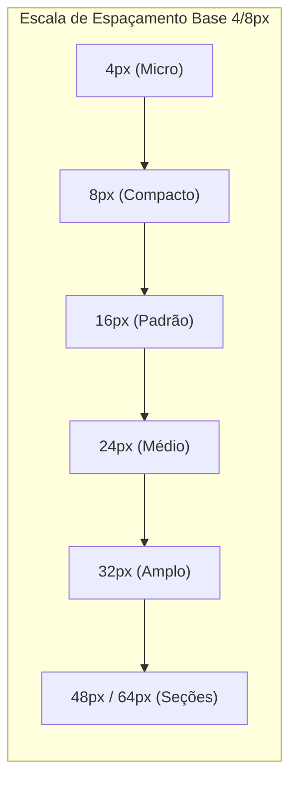

# Auditoria de Design Systems e Consistência de UI

Este documento estabelece o protocolo para auditar a coerência formal e estrutural da interface com base em princípios modernos de Design Systems e Tokens de Design. A consistência reduz o atrito visual e acelera o reconhecimento dos padrões pelo usuário.

---

## 1. Escala Tipográfica e Ritmo Vertical

Uma escala tipográfica previsível estabelece hierarquia clara e orienta a leitura em diferentes níveis de atenção:

| Nível Hierárquico | Tamanho Típico (Desktop) | Tamanho Típico (Mobile) | Altura de Linha (*Line-Height*) | Função na Interface |
|---|---|---|---|---|
| **Display / Hero (`<h1>`)** | 36px a 48px | 28px a 34px | 1.15 a 1.25 | Título de impacto da página principal ou landing page. |
| **Seção Principal (`<h2>`)** | 28px a 32px | 22px a 26px | 1.25 a 1.30 | Cabeçalho de seções temáticas e módulos independentes. |
| **Subseção (`<h3>`)** | 20px a 24px | 18px a 20px | 1.30 a 1.35 | Título de cards, modais e agrupamentos internos. |
| **Corpo de Texto (`body`)** | 16px (mínimo) | 16px (mínimo) | 1.50 a 1.60 | Textos de leitura contínua, descrições e artigos. |
| **Texto de Apoio (`caption`)**| 12px a 14px | 12px a 13px | 1.40 a 1.45 | Rótulos de metadados, legendas de imagens e dicas de formulário. |

### 1.1. Regras de Ouro de Tipografia
- **Tamanho Mínimo no Mobile:** Nunca utilizar corpo de texto inferior a `16px` em campos de formulário no iOS/Safari para evitar o zoom automático forçado pelo navegador ao focar.
- **Comprimento de Linha (*Measure*):** Manter entre 45 e 75 caracteres por linha em blocos de texto corrido. Linhas excessivamente longas dificultam o retorno da leitura visual.

---

## 2. Sistema de Espaçamento e Grid (Escala de 4px / 8px)

A harmonia visual de uma interface depende da adesão a uma unidade base previsível (sistema de 8 pontos com subdivisão de 4 pontos):

- **Inconsistência Típica a Auditar:** Presença de margens arbitrárias como `margin: 13px;` ou `padding: 27px;` sem correspondência com a escala de design tokens.
- **Ritmo Vertical:** O espaçamento superior de um título deve ser maior que o espaçamento inferior para garantir agrupamento perceptual com o parágrafo que ele introduz.

---

## 3. Matriz de Estados de Componentes

Todo componente interativo deve ter seus estados de ciclo de vida claramente diferenciados visualmente:

| Estado do Componente | Indicador Visual Esperado | Sintoma de Falha na Auditoria |
|---|---|---|
| **Default / Padrão** | Superfície legível, contraste adequado, affordance de clique clara. | Elemento parece desabilitado ou confunde-se com o fundo. |
| **Hover (Passagem do Mouse)** | Mudança sutil de luminosidade, elevação de sombra ou realce de borda. | Nenhuma reação visual ao passar o mouse em desktop. |
| **Active / Pressed (Pressionado)** | Sensação tátil de clique (escurecimento ou deslocamento sutil de 1px). | Falta de feedback imediato de acionamento. |
| **Focus-Visible (Foco de Teclado)** | Anel contrastante de 2px a 3px com deslocamento (*offset*). | Anel de foco ausente ou ocultado com `outline: none`. |
| **Disabled (Desabilitado)** | Opacidade reduzida (40%-50%), cursor `not-allowed`, sem hover. | Botão desabilitado mantendo cor idêntica ao botão ativo. |
| **Loading / Carregando** | Spinner integrado ou efeito de pulso mantendo dimensões do botão. | Botão que encolhe ou desaparece durante a espera da API. |
| **Empty State (Estado Vazio)** | Ilustração ou ícone sutil + texto explicativo + botão de ação primária. | Tabela ou lista em branco sem qualquer indicação de ação. |
| **Error State (Estado de Erro)** | Destaque em tom semântico de erro + mensagem contextual clara. | Borda vermelha sem explicar o que causou o erro. |
