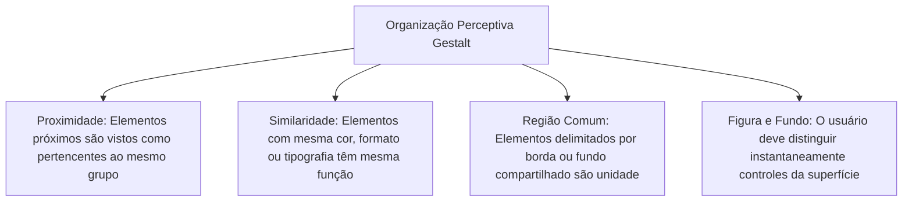

# Framework de Psicologia Cognitiva e Percepção em Interfaces

Este framework orienta a aplicação rigorosa de princípios cognitivos na auditoria de design de interfaces. O objetivo é formular hipóteses testáveis sobre a clareza e o esforço do usuário, sem converter conceitos psicológicos em dogmas universais ou garantias infundadas de conversão.

---

## 1. Princípios Operacionais de Decisão e Atenção

| Princípio Psicológico | Definição no Design de Interfaces | Aplicação Prática na Auditoria | Limitação Epistêmica Obrigatória |
|---|---|---|---|
| **Lei de Hick-Hyman** | O tempo necessário para tomar uma decisão aumenta logaritmicamente com o número e a complexidade das alternativas disponíveis. | Avaliar excesso de itens em menus principais, excesso de CTAs concorrentes na mesma dobra e tabelas de planos com mais de 4 opções sem destaque. | Reduzir opções nem sempre melhora a experiência se ocultar alternativas críticas para o usuário. |
| **Lei de Fitts e Lei de Steering** | O tempo para alcançar um alvo depende da distância até ele e da largura do alvo; trajetórias fechadas aumentam a taxa de erro. | Inspecionar botões de ação primária (tamanho e proximidade do polegar no mobile) e menus suspensos com submenus em túnel estreito. | Trata apontamento físico; não mede compreensão textual nem hesitação na decisão. |
| **Efeito de Posição Serial (Primazia e Recência)** | Usuários tendem a reter melhor o primeiro e o último item de uma lista ou sequência. | Observar a disposição de links em barras de navegação superior, benefícios em landing pages e cartões de preços. | A atenção pode ser redirecionada por peso visual, cor ou animação concorrente. |
| **Teoria da Carga Cognitiva (Sweller)** | A memória de trabalho humana possui capacidade finita de processamento simultâneo. Divide-se em: intrínseca, estranha e pertinente. | Identificar "carga cognitiva estranha": formulários pedindo dados redundantes, jargões técnicos desnecessários e popups intrusivos. | Carga cognitiva é avaliada qualitativamente; não é medida diretamente por número de campos. |
| **Princípio de Jakob (Modelos Mentais)** | Usuários passam a maior parte do tempo em outros sites e esperam que o seu site funcione de maneira consistente com essa experiência acumulada. | Identificar quebras de convenções familiares (ex: carrinho de compras no canto superior direito, logotipo levando à home, ícone de busca). | Inovações legítimas e intuitivas de marca não devem ser penalizadas como defeitos. |

---

## 2. Princípios da Gestalt na Hierarquia Visual

A percepção humana agrupa elementos visuais automaticamente com base em relações espaciais e formais:

### 2.1. Erros Comuns de Proximidade (Espaçamento Falso)
- **Rótulo Flutuante em Formulário:** O rótulo (`label`) fica equidistante do campo anterior e do campo a que pertence, gerando ambiguidade de associação.
- **Títulos Desconectados:** O cabeçalho da seção (`<h2>`) possui o mesmo espaçamento superior e inferior (`margin-top == margin-bottom`), quebrando o agrupamento com o conteúdo seguinte.

### 2.2. Erros de Similaridade e Acessibilidade de Controles
- **Texto Estilizado como Botão:** Elementos puramente informativos estilizados com fundo preenchido e cantos arredondados parecendo botões clicáveis (*affordance falsa*).
- **Links Primários sem Diferenciação Visual:** Links de navegação secundária compartilhando a mesma cor e peso tipográfico do CTA principal de conversão.

---

## 3. Diretrizes para Registro de Hipóteses no Relatório

Ao aplicar este framework em um achado de auditoria:

1. **Separação Obrigatória no JSON (Schema v3):**
   - No campo `evidence_observed`: descreva apenas a disposição visual concreta (ex: "Existem 14 opções de filtros exibidas simultaneamente sem agrupamento temático").
   - No campo `inference`: relacione com a tarefa (ex: "O usuário que busca uma categoria específica precisa escanear visualmente uma lista longa").
   - No campo `hypothesis`: aponte a fricção cognitiva provável (ex: "A dispersão de opções pode aumentar a hesitação na escolha, conforme a Lei de Hick-Hyman").
2. **Confiança Ponderada:**
   - Hipóteses fundamentadas em psicologia sem teste empírico de usuários devem ter confiança máxima `medium` ou `low`.
   - Nunca use `priority: P0` exclusivamente com base em teoria psicológica se a interface permitir a conclusão da tarefa.
