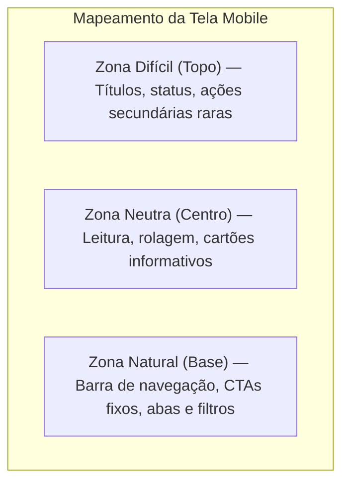

# Guia de Auditoria de Usabilidade Mobile e Responsividade

Este guia reúne as diretrizes para auditar a ergonomia em smartphones e tablets, inspecionando como a interface se adapta a telas sensíveis ao toque, larguras estreitas e contextos de uso em movimento.

---

## 1. Ergonomia da Zona do Polegar (Thumb Zone)

Em smartphones modernos (telas de 5.8" a 6.7"), a maior parte da navegação com uma só mão ocorre na metade inferior da tela:

- **Ações Primárias na Base:** Botões de conversão ("Comprar", "Continuar", "Confirmar") e menus de navegação principal devem ser posicionados na zona natural de alcance do polegar.
- **Falha Crítica Comum:** Posicionar o único botão de avançar no canto superior direito de uma tela longa de formulário mobile, forçando o usuário a reajustar a pegada do aparelho.

---

## 2. Padrões de Navegação e Sobreposição em Telas Pequenas

| Padrão de Interface | Implementação Recomendada no Mobile | Erro Comum a Evitar |
|---|---|---|
| **Janelas Modais** | Substituir por **Bottom Sheets** (gavetas inferiores) ancoradas na base da tela. | Modais centralizados que ocupam toda a tela e empurram o botão "Fechar" para fora da área visível. |
| **Tabelas de Dados Extensas** | Transformar em cartões empilhados (*stacked cards*) ou tabela com coluna fixa e rolagem horizontal com indicador visível. | Tabela rígida que força zoom manual ou estoura a largura da página gerando scroll horizontal indesejado. |
| **Filtros e Ordenação** | Painel lateral deslizante ou gaveta inferior com contador de filtros aplicados. | Acordeões infinitos empurrando a listagem de produtos para quilômetros abaixo da dobra. |
| **Cabeçalhos e Rodapés Fixos (*Sticky*)** | Altura compacta (< 60px) para não roubar mais de 15% da altura útil da tela. | Cabeçalho fixo + banner de cookies ocupando 50% da tela durante a rolagem. |

---

## 3. Otimização de Formulários e Teclados Virtuais

Ao tocar em um campo de entrada no mobile, o teclado virtual ocupa entre 40% e 55% da altura da tela:

1. **Tipos Corretos de Input e Atributos de Teclado:**
   - Campos de telefone devem ter `type="tel"`.
   - Campos numéricos (CEP, CPF, código SMS) devem ter `inputmode="numeric"` para abrir o teclado numérico direto.
   - Campos de e-mail devem ter `type="email"` com desativação de autocapitalização (`autocapitalize="none"`).
2. **Visibilidade do Campo Focado:** O campo em digitação não pode ficar oculto sob o teclado virtual. O navegador ou script deve garantir auto-scroll suave para manter o campo e seu botão de envio visíveis.
3. **Preenchimento Automático (*Autocomplete*):** Inclusão de atributos semânticos (`autocomplete="name"`, `autocomplete="email"`, `autocomplete="address-line1"`, `autocomplete="postal-code"`) para acelerar preenchimentos e reduzir erros de digitação em telas de toque.
