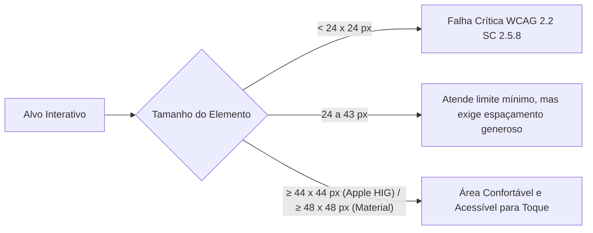

# Heurísticas de Acessibilidade no Nível do Design (UX/UI)

Este guia estabelece os parâmetros de avaliação de acessibilidade sob a ótica do design de interfaces. A auditora avalia a usabilidade inclusiva na experiência visual e interativa observada, sem emitir certificação formal de conformidade com WCAG técnica completa.

---

## 1. Contraste Visual e Legibilidade Cromática

A legibilidade de texto e elementos de controle é pré-requisito fundamental para clareza e redução do esforço cognitivo.

| Elemento | Padrão Mínimo Recomendado | Método de Verificação | Falha Comum Observada |
|---|---|---|---|
| **Texto Normal (< 18pt ou < 14pt bold)** | Contraste de **4,5 : 1** contra o fundo imediato. | Medição via `extract-styles.mjs` ou conta-gotas em captura. | Texto cinza claro sobre fundo branco (`#888888` sobre `#FFFFFF` = ~3,5:1). |
| **Texto Grande (≥ 18pt ou ≥ 14pt bold)** | Contraste de **3,0 : 1** contra o fundo imediato. | Medição direta no render. | Títulos em cores institucionais desbotadas sobre banners fotográficos. |
| **Componentes de Interface e Ícones Ativos** | Contraste de **3,0 : 1** para bordas de inputs, botões e ícones funcionais. | Inspeção visual e árvore de estilos computados. | Bordas de campos de formulário cinza quase invisíveis (`#E5E5E5`). |
| **Texto sobre Imagens ou Gradientes** | Proteção por camada de sobreposição (*overlay*) ou sombra legível. | Inspeção visual no viewport mobile e desktop. | Texto branco sobre partes claras de fotos sem máscara de escurecimento. |

---

## 2. Dimensões de Alvos de Toque (Touch Targets)

Elementos interativos devem ser dimensionados e espaçados para prevenir toques acidentais, especialmente em dispositivos móveis.

- **Alvos Mínimos em Mobile:** Botões, ícones de menu, links de rodapé e checkboxes devem oferecer área clicável de pelo menos `44 x 44 px` (incluindo padding transparente se o ícone visual for menor).
- **Espaçamento entre Alvos:** Pelo menos `8 px` de distância entre alvos adjacentes para evitar acionamentos concorrentes.

---

## 3. Estados de Foco Visível (`:focus-visible`) e Navegação por Teclado

Usuários que navegam por teclado ou dispositivos assistivos precisam de feedback visual imediato de sua localização na tela.

1. **Anel de Foco Perceptível:** O indicador de foco não deve ser removido com `outline: none` ou `outline: 0` sem a substituição por um anel alternativo de alto contraste (ex: `outline: 2px solid #2563EB; outline-offset: 2px;`).
2. **Ordem Lógica de Foco (DOM Sequence):** A navegação por Tab deve seguir a leitura natural da interface (esquerda para a direita, cima para baixo), sem saltos inesperados provocados por `order` no Flexbox ou Grid.
3. **Prevenção de Armadilhas de Teclado (Keyboard Traps):** Modais e gavetas laterais (*drawers*) devem reter o foco enquanto abertos e fecháveis via tecla `Escape`.

---

## 4. Comunicação Não Dependente Exclusivamente de Cor

Informações críticas de estado não podem ser transmitidas exclusivamente por variações cromáticas, atendendo usuários com daltonismo e ambientes de alta luminosidade solar.

- **Mensagens de Erro em Formulários:** Devem conter ícone de aviso + texto explicativo explícito (ex: "E-mail inválido"), e não apenas a borda do campo ficando vermelha.
- **Gráficos e Dashboards:** Devem utilizar texturas, padrões de traço ou rótulos diretos nas séries, além de cores diferenciadas.
- **Links em Corpo de Texto:** Se não forem sublinhados, devem possuir contraste cromático de pelo menos `3:1` em relação ao texto ao redor e exibir sublinhado no estado de hover/focus.

---

## 5. Sensibilidade a Movimento e Transições

- Respeito à preferência do usuário declarada via media query `@media (prefers-reduced-motion: reduce)`.
- Animações de parallax intensas, rotações contínuas ou deslocamentos amplos devem ser suavizados ou substituídos por crossfades sutis para prevenir náuseas vestibulares.
